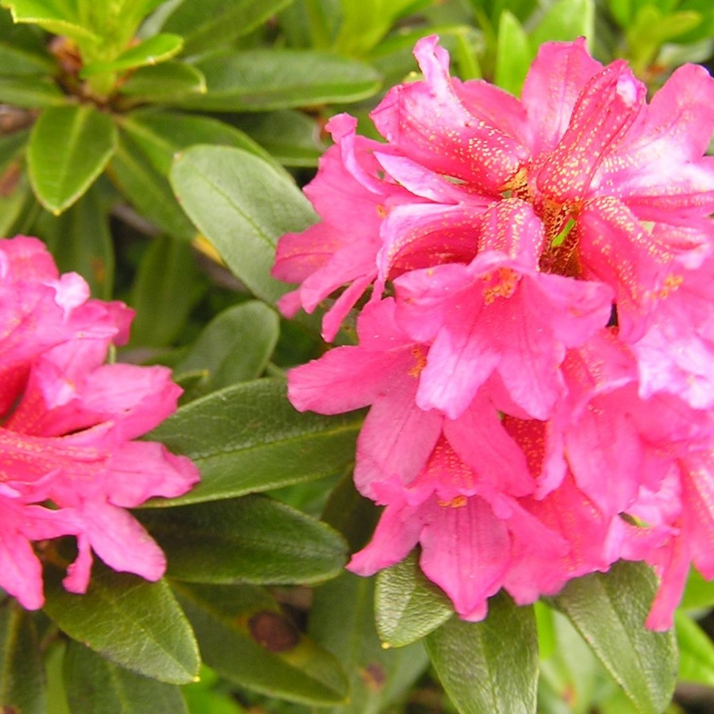

# WebGPU Image to Gaussian Splat

<div align="center">
  
  
</div>

From scratch implementation of gaussian splatting pipeline that fits 2D gaussians on images following the same techniques of the
original [3D Gaussian Splating paper](https://arxiv.org/pdf/2308.04079)

It is not a perfect splatter, but a blog for me (and you) to more deeply understanding how WebGPU and Gaussian Splatting works and have a fun interactive webinterface to play around with.

## Blog

The following [articles](https://cedi-code.github.io/webgpu-img2splat/journey-intro.html) document the step-by-step journey of making img2splat in WebGPU with interactive examples.


## Technical stuff

- **WebGPU optimization:** Render and optimize 2D Gaussian splats with WGSL
  render and compute shaders, including parallel forward, backward, and
  gradient-reduction passes.
- **Parallel radix sort:** Organize splat/chunk pairs on the GPU with prefix
  sums, parallel radix sorting, and chunk offsets so each image tile processes
  only the splats that overlap it.
- **Adam updates:** Apply Adam-based parameter updates to splat position,
  color, scale, rotation, and opacity during image optimization.
- **Splat densification:** Refine scenes by duplicating under-reconstructed
  splats, splitting over-sized splats, and pruning splats that are no longer
  useful.
- **Depth and checks:** Experiment with depth-aware rendering and validate
  shader gradients against numerical gradient checks.

> SSIM is discussed as a possible future loss in the journey, but it is not
> implemented in the current renderer.

## Folder structure

```text
.
├── assets/                  # blog and example images
├── src/
│   ├── journey/             # Technical implementation and articles
│   │   ├── markdowns/       # blog explanations
│   │   └── scripts/         # blog+main scripts
│   │       └── shaders/     # blog+main WGSL shaders
│   ├── config/              # Renderer configuration
│   ├── myutils/             # Shared utility helpers
│   └── tests/               # Shader and gradient tests
├── index.html
├── package.json
└── vite.config.ts
```

## How to run

### Requirements

- Node.js and npm
- WebGPU browser

```bash
npm install
npm run dev
```

```bash
npm run build
npm run preview
```
